## About

I'm a full-stack developer and BS Information Systems student based in Dasmariñas, Cavite. I design interfaces in Figma and build web apps with React, Laravel, and Supabase. My projects include a school transparency platform, a local-first focus app, and a birthday-sharing app.

## Highlights

## Selected projects

  

  
  

  

  

  

## Tools and technologies

## GitHub activity

  

  
  

## Certifications

  
  
  
  

## Contact

  
  
  
  

